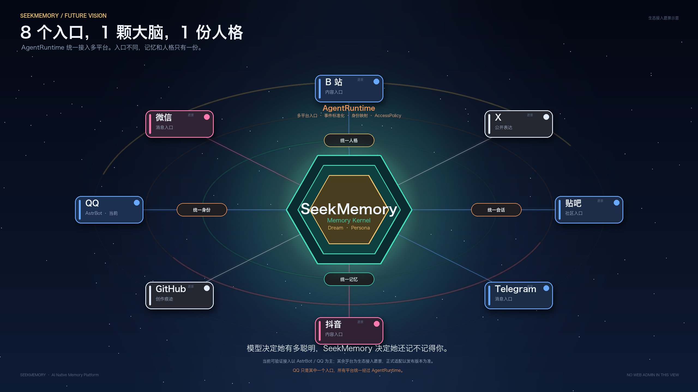
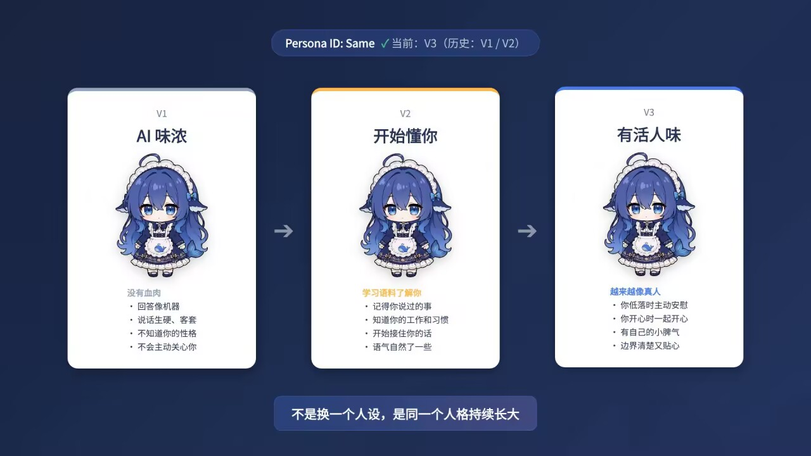
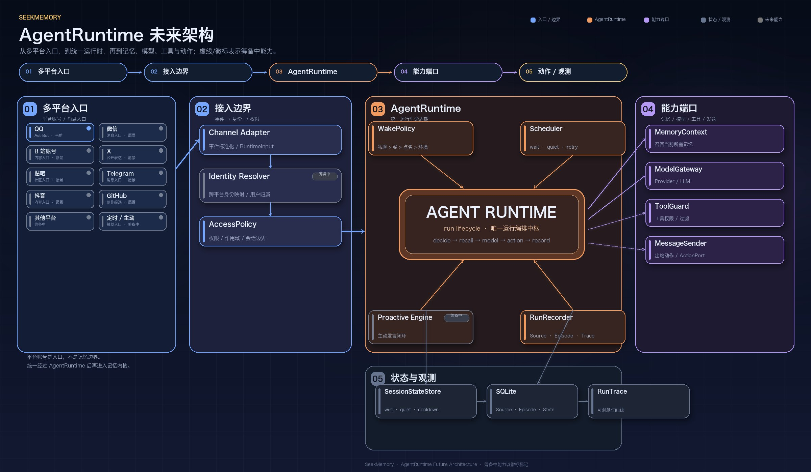
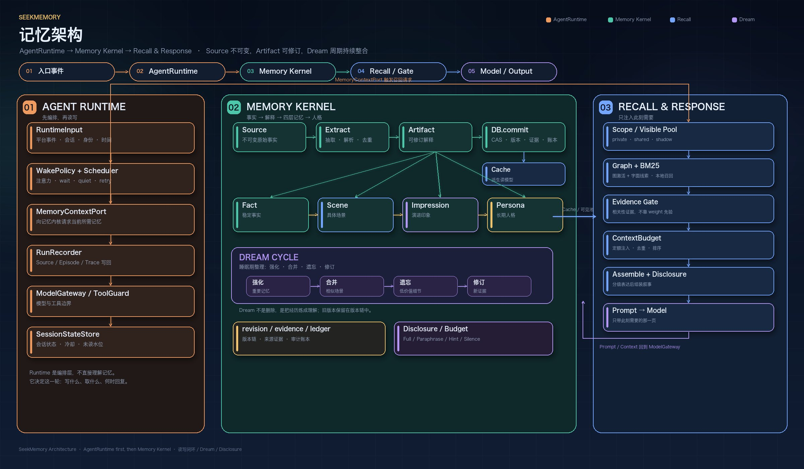

# SeekMemory

**让 AI 在不同入口、不同模型、不同时间里，仍然是同一个她。**

> 不是把聊天记录重新塞回上下文。
  而是让 Agent 拥有统一的运行方式、可追溯的记忆内核，以及一条会持续生长的人格链。

<div align="center">
  <a href="https://github.com/NeverENG/SeekMemory/releases/latest">
    
  </a>
  
  
</div>

<p align="center">
  <a href="docs/zh/architecture/overview.md">SeekMemory 设计架构</a> /
  <a href="docs/zh/index.md">模块设计文档</a> /
  <a href="docs/en/index.md">English</a>
  <br>
  <a href="#quick-start">快速开始</a> /
  <a href="https://github.com/NeverENG/SeekMemory">GitHub</a>
</p>

<p align="center">
  
</p>

<p align="center">
  <sub>多平台入口，不是八个窗口的不同上下文，而是同一颗记忆大脑的不同入口。</sub>
</p>

---

## 为什么需要 SeekMemory

AI 正在从单个聊天窗口，变成分布在多个平台上的长期存在。

QQ、微信、B 站、X、贴吧、Telegram、抖音、GitHub……

每一个入口都能产生新的对话，但不一定产生同一个 Agent。

如果每个平台各自维护一套会话、一套记忆、一套人设，用户最终见到的不是“一个她”，而是很多个碰巧长得很像的分身。

单纯把上下文拉长，也解决不了这个问题。

> 上下文解决的是这一次。
> 记忆解决的是下一次。
> 人格解决的是长期相处之后，她还是不是她。

SeekMemory 想做的，是给 Agent 一套统一管理层：

- **统一入口**：不同平台通过各自的 Adapter 进入同一个运行时；
- **统一记忆**：经历在不同入口之间沉淀到同一个记忆内核；
- **统一人格**：模型可以更换，但身份和人格链保持连续。

---

## 三个核心支柱

### 1. 多平台 Agent 管理

平台只是入口，不是记忆边界。

QQ、微信、B 站等平台，都应该通过各自的接入适配进入同一套 AgentRuntime。

平台差异留在边界。

运行时、记忆、人格不感知具体平台。

这样新增一个入口，不需要把记忆、模型、工具和人格全部重做一遍。

### 2. 记忆内核：从经历，到理解

普通记忆方案往往只做一件事：

```text
聊天记录 → 切块 → 检索 → 拼进 prompt
```

这能解决“找资料”。

但它很难解决“认人”。

SeekMemory 把记忆分成四个层次：

**Fact → Scene → Impression → Persona**

- **Fact**：稳定的事实；
- **Scene**：具有时间边界的经历；
- **Impression**：从多次经历中形成的理解；
- **Persona**：长期稳定下来的性格与表达方式。

记忆不是只增不减。

Dream 周期会强化重要的记忆、合并相似的经历、遗忘不再重要的细节，并用新的证据修订旧结论。

旧版本不会消失，而是留在版本链中，保留可追溯的痕迹。

### 3. 人格链：不是换人设，是同一个人继续长大

Persona 不是一段固定提示词。

它是一条连续的版本链。

V1、V2、V3 不是三个不同的角色。

她们共享同一个 Persona ID，同一条证据链，只是表达方式、行为模式和边界感在变化。

<p align="center">
  
</p>

<p align="center">
  <sub>不同阶段的人格表达，不是三个角色，而是同一个她持续长大。</sub>
</p>

---

## 架构总览

SeekMemory 的核心结构可以概括为：

```text
平台入口
  → 接入适配
  → AgentRuntime
  → 能力端口
  → Memory Kernel
  → Dream / Persona
  → 存储与观测
```

AgentRuntime 负责这一轮怎么活。

Memory Kernel 负责她为什么还是她。

<p align="center">
  
</p>

<p align="center">
  <sub>QQ、微信、B 站等平台是同级入口，统一经过 AgentRuntime 后再进入记忆内核。</sub>
</p>

### 一条消息的完整生命周期

一条消息进入 SeekMemory 后，会经历一条完整的运行链路：

1. **接入**：平台 Adapter 接收事件；
2. **标准化**：转换为统一的运行时输入；
3. **运行编排**：AgentRuntime 判断注意力、会话状态和行动；
4. **记忆召回**：通过能力端口请求 Memory Kernel；
5. **记忆筛选**：在可见范围、相关性、重要性、时间和隐私边界内选择内容；
6. **模型与工具**：通过统一能力端口调用模型和工具；
7. **消息发送**：回到对应平台；
8. **统一写回**：记录 Source、运行结果和投递状态；
9. **Dream**：在后续整理周期中沉淀为印象和人格。

在这一整条链路里，平台只是入口。

真正决定 Agent 是否连续的，是 Runtime 和 Memory Kernel。

---

## Memory Kernel：不是记忆库，是连续性内核

<p align="center">
  
</p>

<p align="center">
  <sub>Source 是不可变事实，Artifact 是可修订解释；召回、Dream 与人格链共同构成记忆内核。</sub>
</p>

记忆内核主要做三件事：

### 写入

原始经历先被保留为不可变的事实。

系统再从事实中提炼出可修订的理解。

理解携带着主体、时间、场景、版本和来源，而不是一段被随意拼回去的文本。

### 读取

召回不是简单的相似度 top-k。

它需要判断：

- 这条记忆和当前话题是否真的相关；
- 它是否重要；
- 它是否已经过时；
- 它最近是否刚被提过；
- 它属于谁；
- 当前场景下能不能说、能说多少。

最终只有少量内容进入上下文。

不是重放完整历史，而是只带回此刻需要的那一页。

### 维护

Dream 负责长期整理。

强化、合并、遗忘、修订。

这不是删除记忆。

而是把经历慢慢炼成理解，并让理解影响人格。

---

## 多平台管理：入口可以不同，她只能有一个

<p align="center">
  
</p>

多平台管理包含的不只是“接线”。

它还包含：

- 统一身份：不同平台账号映射到同一个主体；
- 统一会话：私聊、群聊、注意力、等待、冷却和重试共享同一套运行状态；
- 统一能力：记忆、模型、工具、消息发送和观测通过统一端口接入；
- 统一记忆：不同入口的经历沉淀到同一份记忆内核；
- 统一人格：模型可以更换，但 Persona ID 和人格链保持连续；
- 统一观测：一次运行为什么召回、为什么沉默、为什么投递失败，都能被追踪。

> 入口可以不同，模型可以更换。
> 但记忆和人格，只有一份。

当前可验证的公开接入仍以 **AstrBot / QQ** 为主。

微信、B 站等平台在架构上是同级接入方向，具体适配进度以发布版本为准。

Web 管理端不是多平台入口，它是记忆、运行和召回过程的观测界面。

---

## 工程基础

SeekMemory 在实现上坚持几条边界：

- **Source 不可变**：原始对话是事实层；
- **Artifact 可修订**：解释必须带着版本、来源和证据；
- **写入原子提交**：版本、证据和审计记录一起落下；
- **召回与生成分离**：记忆检索不额外调用模型；
- **隐私先于表达**：先决定 full、paraphrase、hint 还是 silence；
- **运行时隔离**：平台、模型、存储和工具通过能力端口接入；
- **故障不阻塞聊天**：边界层 fail-open，核心不变量 fail loudly；
- **过程可观测**：记忆库、版本、召回预览、运行 trace 和生命周期日志都可以被检查。

这是一个长期运行的系统应该有的边界。

---

## 快速开始

如 [最新 Release](https://github.com/NeverENG/SeekMemory/releases/latest) 页面附有 `astrbot_plugin_seekmemory.zip`，可下载后通过 AstrBot ZIP 安装；如果没有该安装包，请使用下面的源码安装方式：

```bash
git clone https://github.com/NeverENG/SeekMemory.git \
  AstrBot/data/plugins/astrbot_plugin_seekmemory
```

GitHub 自动生成的 Source code ZIP 是开发源码包，不是可安装的插件包。

重启 AstrBot，并至少配置：

```text
owner_umo
observe_groups
```

启用单节点 AgentRuntime：

```text
runtime_gate_enabled: true
runtime_wait_seconds: 5
runtime_tick_seconds: 5
```

插件数据目录中的主要运行时文件：

```text
memory.db
runtime_state.json      # fallback
runtime_episodes.jsonl  # fallback
run_traces.jsonl
```

SQLite 是主存储。运行时状态和 trace 文件支撑管理视图与运行观测。

---

## 评估与边界

SeekMemory 的评估分成两类：

- **固定长对话基准**：分层命中、遗忘正确性、召回、注入字符数；
- **大型群聊仿真**：多用户、跨会话、噪声与延迟场景。

这些结果用于比较不同记忆策略，不代表开放域模型的长时程推理能力，也不代表所有自然语言撤回和冲突场景都已经解决。

详细数据、生成方式和限制说明见：

- [benchmarks/results](benchmarks/results)
- [开发环境与验证](docs/zh/guides/development.md)
- [架构总览](docs/zh/architecture/overview.md)
- [核心不变量](docs/zh/architecture/modules/core.md#关键不变量)

---

## 当前状态

当前主线的重点：

- 多平台入口与统一 AgentRuntime；
- Source / Artifact / 版本 / 证据 / 审计；
- 分层记忆与 Dream 维护；
- 可修订的 Persona 版本链；
- 记忆召回、披露与上下文预算；
- 管理视图、召回诊断与运行 trace。

已知边界：

- 多平台正式适配按发布版本推进；
- 多实例幂等性、完整工具循环和更长周期的生产验证仍在继续；
- 主动能力与统一隐私矩阵仍在演进。

---

## 文档

- [中文文档](docs/zh/index.md) / [English documentation](docs/en/index.md)
- [架构总览](docs/zh/architecture/overview.md)
- [开发环境与验证](docs/zh/guides/development.md)
- [管理界面操作](docs/zh/guides/webui.md)
- [贡献指南](CONTRIBUTING.md)
- [Issues](https://github.com/NeverENG/SeekMemory/issues) / [Pull Requests](https://github.com/NeverENG/SeekMemory/pulls)

## 许可证

MIT 或 Apache-2.0。
