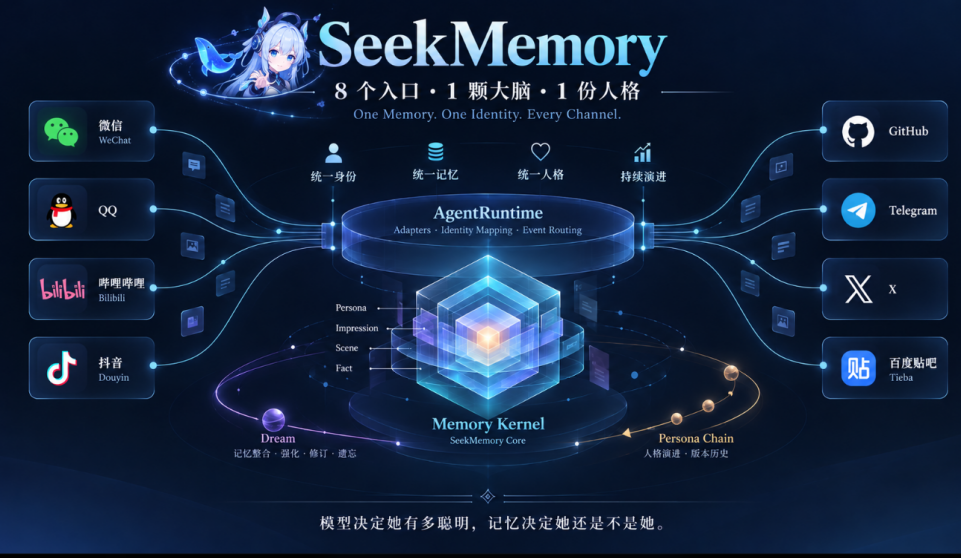

# SeekMemory

**一个面向长期陪伴的 AgentRuntime 与记忆内核。**

> 平台只是入口。Runtime 负责这一轮怎么活，Memory Kernel 负责她为什么还是她。

<div align="center">
  <a href="https://github.com/NeverENG/SeekMemory/releases/latest">
    
  </a>
  
  
</div>

<p align="center">
  <a href="docs/zh/architecture/overview.md">架构总览</a> /
  <a href="docs/zh/index.md">文档</a> /
  <a href="docs/en/index.md">English</a>
  <br>
  <a href="#quick-start">快速开始</a> /
  <a href="#verification">验证</a> /
  <a href="https://github.com/NeverENG/SeekMemory/issues">Issues</a>
</p>

<p align="center">
  
</p>

<p align="center">
  <sub>多平台入口不是多套上下文，而是同一颗记忆大脑的不同入口。</sub>
</p>

---

## 工程定位

SeekMemory 不是“把聊天记录切块再塞进 prompt”的检索器，而是给 Agent 提供一套长期运行基础件：

- **Host-neutral Runtime**：平台事件只经过 Adapter 和 RuntimeInput；
- **可追溯记忆**：Source 是不可变证据，Artifact 是可修订解释；
- **可解释召回**：相关性、强度、时间、证据、披露和预算共同决定上下文；
- **统一动作**：Runtime 发起动作走 ActionExecutor -> ActionPort；
- **连续人格**：Persona 不是一段固定 prompt，而是一条带证据的版本链；
- **边界清晰**：平台差异留在 host adapter，不污染核心运行时。

## 系统边界

```text
Platform / Host
  -> PlatformAdapter
       toRuntimeInput(session, event)
       executeAction(ActionRequest)
  -> HostBridge
       acceptUser / context / records
  -> RuntimeInput
  -> AgentRuntime
       SessionState
       AttentionPolicy
       RunControl / RunPolicy
       Worker / Scheduler
       ActionExecutor
  -> MemoryContextPort / ModelGateway / ActionPort
  -> Platform / Host
```

| 层 | 职责 | 不负责 |
|---|---|---|
| `adapters/*` | 平台事件转换、宿主能力注入 | attention、proactive、memory 策略 |
| `AgentRuntime` | session 状态、是否回复、何时回复、run 生命周期 | 平台 SDK、SQLite、人设文案 |
| `Memory Kernel` | Source / Artifact / 版本 / 召回 / 披露 | 平台发送、模型对话循环 |
| `ActionExecutor` | attempt -> terminal、动作审计 | 平台 API 实现 |
| `ActionPort` | 平台发送、回复、转发等能力 | 记忆与决策 |

`session_id` 是运行 lane，`speaker_id` 是事件参与者，`subject_key` 是跨 session 的共享记忆主体。三者不能混用。

---

## 运行链路：AgentRuntime V3


*平台只是入口；RunControl 以 session 为边界，同会话替换旧 run，跨会话互不抢占。*

### 一条消息的完整生命周期

```text
1. Adapter       接收平台事件
2. normalize     -> RuntimeInput
3. Runtime       记录 Source / 更新 SessionState / 评估注意力和动作
4. context       向 MemoryContextPort 请求有界记忆上下文
5. model         通过 ModelGateway 调用宿主模型
6. action        通过 ActionExecutor + ActionPort 发回平台
7. record        Source / Episode / Trace / delivery cursor
8. dream         离线强化、合并、遗忘、修订，进入人格链
```

### 核心契约

> 以下是 V3 目标契约；当前 `app/runtime/contracts` 与 Issue #154 是实际实现的准绳。

```python
RuntimeInput(
    session_id: str,
    text: str,
    speaker_id: str = "",
    subject_key: str = "",
    event_id: str = "",
    event_time: float = 0.0,
    received_at: float = 0.0,
)
RunDecision(action, reason, attention, must_reply)
ActionRequest(session_id, kind, text="")
```

### 中断语义

V3 不是“所有消息一来就杀 run”，而是把中断做成可注入的运行时能力：

| 场景 | 行为 |
|---|---|
| 同 session 新 user input | 取消旧 run，启动新 run |
| 不同 session | 互不取消 |
| 新 user input vs active proactive | 不启动 proactive |
| 取消发生在 ActionPort 前 | action terminal = `cancelled` |
| ActionPort 已经执行 | 记录真实 success / failure，不伪造 cancelled |
| “我去刷视频了” | 语义暂停，不取消正在生成的回复 |

```text
RunPolicy  决定是否替换
RunHandle  提供协作式 cancel token
Runtime    负责 run 生命周期
Host       负责把自己的模型/发送任务接到 token 上
```

实现设计见 [Runtime V3 Issue #154](https://github.com/NeverENG/SeekMemory/issues/154)。

---

## 记忆内核：Source → Artifact → Recall


*Source 是不可变证据，Artifact 是可修订解释；召回由强度、相关性、证据闸门、披露和预算共同决定。*

### 写入

```text
Source
  -> Perceive / Extract
  -> Artifact
  -> DB.commit（版本、证据、账本同一事务）
  -> Cache（派生读模型）
```

- Source 只追加，不覆盖；
- Artifact 每次修订保留稳定 ID 和 revision；
- `subject_id`、`said_by`、`lineage.sources` 分别表示“关于谁”、“由谁产生”、“由哪些证据支持”；
- 写入失败保留待处理行，不把不完整输入静默标记为成功。

### 读取

```text
Scope / Visible Pool
  -> Graph activation + BM25
  -> Recall score
  -> Evidence Gate
  -> Disclosure
  -> ContextBudget
  -> Prompt
```

召回不是单纯的 top-k：相关性证据决定“能不能进来”，强度、新鲜度、最近使用和 activation 参与排序，主体、scope 和敏感度决定“能说多少”，最终由 ContextBudget 截断为有界上下文。

### 算法因子

| 因子 | 当前实现 |
|---|---|
| 留存率 | `R(t) = exp(-t / S)` |
| 稳定度 | `S = 30 × salience × (1 + 0.5×hits) × shape × emotion` |
| shape | `point 1.0 · span 1.2 · pattern 3.0 · rule 999` |
| 强化 | `recall +0.1 · spoken +0.3 · confirmed +0.2` |
| 命中冷却 | 30 分钟 |
| 排序分 | `3.0×literal + 2.0×tag + 1.5×emotion + 1.0×weight + 0.5×freshness + 1.5×activation − 2.0×recent` |
| 新鲜度 | `exp(-age_days / 14)` |
| 探索 | `0.1`，按输入文本稳定采样 |
| 证据闸门 | `max(0.5, top_evidence × 0.3)` |
| 披露 | `context_affinity × subject_fit × scope_prior × (1−sensitivity) × topic` |

---

## Dream 与人格链


*Dream 在离线周期中分类、强化、合并、遗忘和修订，再把稳定行为沉淀进同一人格链。*

```text
DreamCycle (03:30, idempotent, resumable)
  -> Flush / Extract (triage)
  -> Memory Classification (Fact / Scene / Impression / Persona)
  -> Strength / Merge / Forget / Revise
  -> Self Impression (≥3 independent evidence, confidence ≥ 0.9)
  -> Persona Evolution (Top 3 behaviors + seed evolution)
  -> Active Persona / revision chain
  -> Dream ledger
```

Dream 有明确预算：`batches ≤ 12`、`calls ≤ 12`、`tokens ≤ 60k`。中途失败保留待处理行，下一次从断点继续；同一天重跑幂等。

人格链不是固定 prompt，而是一条带证据的版本链：

```text
Seed Persona
  -> Self Impression
  -> Behavior candidates
  -> Dream evolution
  -> Active Persona
  -> History / rollback
```

---

## 平台接入契约

平台插件只做两件事：把平台事件映射成 `RuntimeInput`，把 `ActionRequest` 执行成平台 API。

```js
createPlatformAdapter({
  platform: 'qq',
  capabilities: { private: true, mention: true, replyTo: true },
  toRuntimeInput(session, event) { ... },
  executeAction(request) { ... },
})

const bridge = createHostBridge({ kernel, adapter, logger })
```

`DshSession` / `DshEvent` 由 DSH 或平台插件拥有，SeekMemory 不冻结其内部形状。

| 宿主 | 接入方式 | 状态 |
|---|---|---|
| AstrBot | `adapters/astrbot` | 生产线可验证 |
| DSH | `dsh-seekmemory/platform-contract` + `host-bridge` | 基础契约已落地，平台插件并行开发中 |
| 其他平台 | PlatformAdapter | 需要 thin adapter |

契约细节见 [`adapters/dsh/PLATFORM-CONTRACT.md`](adapters/dsh/PLATFORM-CONTRACT.md) 和 [Issue #150](https://github.com/NeverENG/SeekMemory/issues/150)。

---

## 仓库结构

```text
app/runtime/          AgentRuntime、策略、ActionExecutor、Worker
app/runtime/contracts RuntimeInput / RunDecision / ActionRequest / ports
core/                 Source / Artifact / version / disclosure / strength
perceive/             DialogueTurn、抽取、重要性
recall/               图激活、BM25、gate、assembly
maintain/             decay / merge / self impression / persona
app/dream.py          DreamCycle 编排
services/             维护、抽取、召回等用例
store/                SQLite、版本仓储、缓存
adapters/astrbot/     AstrBot 宿主适配
adapters/dsh/         DSH host bridge + platform contract
dashboard/            管理界面
webui/                宿主无关 API / journal / trace
```

实现边界：core 不依赖宿主或存储；SQL 只在 store；AstrBot/DSH 类型留在 adapters；服务层组合业务模块。

---

## Quick Start

优先使用 [最新 Release](https://github.com/NeverENG/SeekMemory/releases/latest) 中的 `astrbot_plugin_seekmemory.zip`，在 AstrBot 里通过 ZIP 安装。

源码安装：

```bash
git clone https://github.com/NeverENG/SeekMemory.git \
  AstrBot/data/plugins/astrbot_plugin_seekmemory
```

重启 AstrBot，至少配置：

```text
owner_umo
observe_groups
runtime_gate_enabled: true
```

插件数据目录：

```text
memory.db                 # SQLite 主存储
runtime_state.json        # fallback / 导入导出
runtime_episodes.jsonl    # fallback / 观测
run_traces.jsonl          # 运行 trace
```

---

## Verification

```bash
python3 scripts/run_tests.py --layer unit
python3 scripts/run_tests.py --layer integration
python3 scripts/run_tests.py --layer smoke
python3 scripts/check_docs_structure.py

cd adapters/dsh && npm test
```

真实 AstrBot 宿主测试需要可用宿主环境；CI 覆盖 Python 3.10/3.11/3.12、前端契约、Node adapter、打包内容和真实 Python AgentRuntime loopback。

## 当前状态

已落地：

- AgentRuntime 会话状态、注意力策略、延迟派发与主动话题；
- Source / Artifact / revision / evidence / ledger；
- Graph + BM25 召回、证据闸门、披露和上下文预算；
- Dream / 人格链 / 记忆强化；
- ActionExecutor 单一动作链路；
- AstrBot 生产适配和 DSH platform contract。

继续演进：

- V3 RunControl 中断实现：[Issue #154](https://github.com/NeverENG/SeekMemory/issues/154)；
- DSH QQ / B站 / X 平台插件：[Issue #150](https://github.com/NeverENG/SeekMemory/issues/150)；
- 多实例幂等、完整工具循环和更长周期生产验证。

## 文档

- [中文文档](docs/zh/index.md) / [English documentation](docs/en/index.md)
- [架构总览](docs/zh/architecture/overview.md)
- [Runtime 模块](docs/zh/architecture/modules/runtime.md)
- [Recall 模块](docs/zh/architecture/modules/recall.md)
- [开发环境与验证](docs/zh/guides/development.md)
- [贡献指南](CONTRIBUTING.md)

## License

MIT 或 Apache-2.0。
