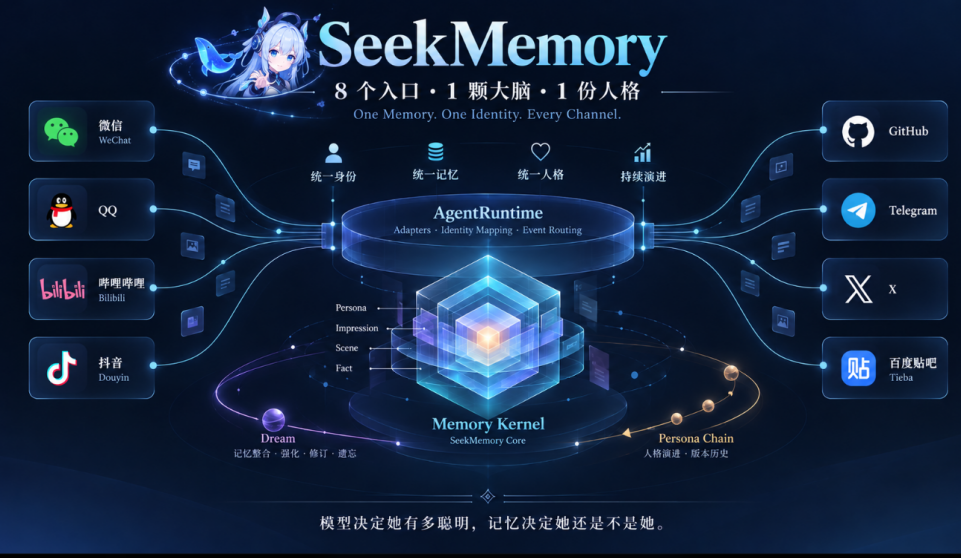
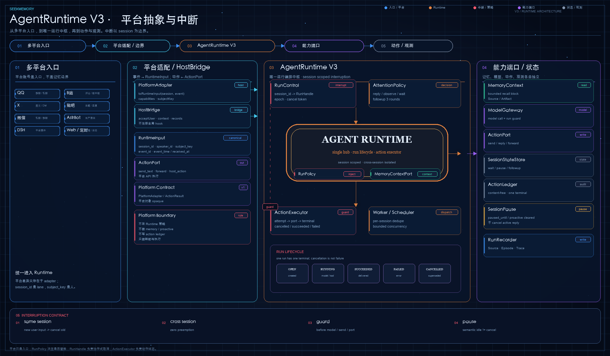
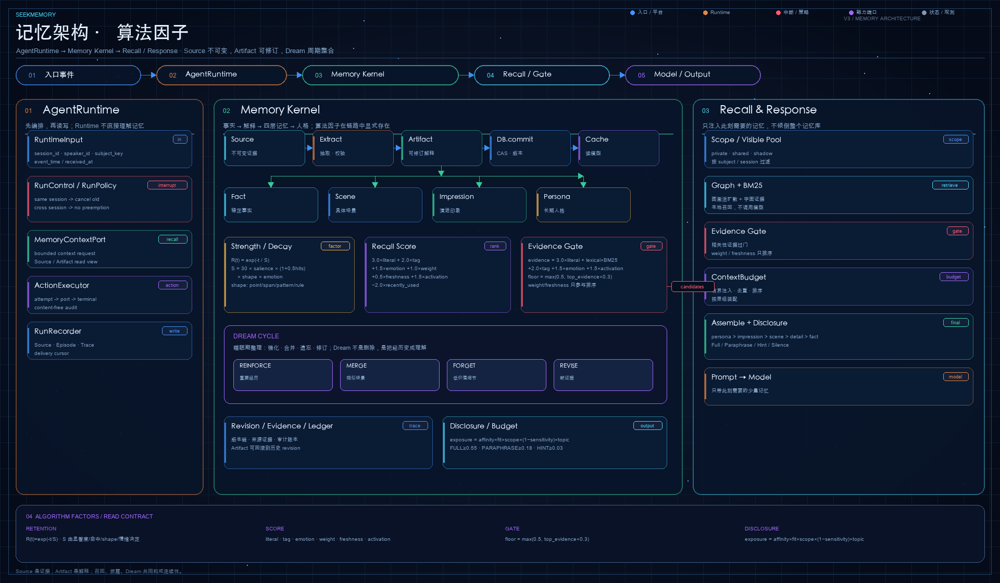
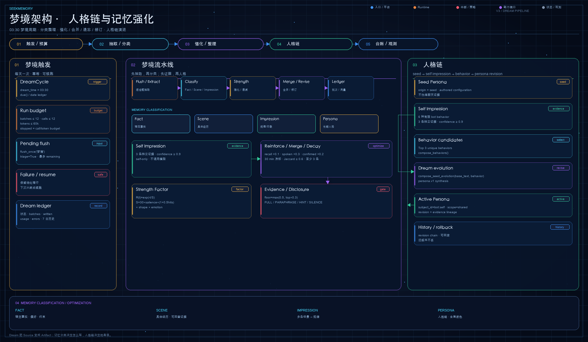

# SeekMemory

**以 AgentRuntime 为中心的长期运行 Agent 基础设施。**

> AgentRuntime 协调输入、任务准入、中断与动作；Memory Kernel 为持续互动提供有证据的上下文。

<div align="center">
  <a href="https://github.com/NeverENG/SeekMemory/releases/latest">
    
  </a>
  
  
</div>

<p align="center">
  <a href="docs/zh/architecture/modules/runtime.md">Runtime 契约</a> /
  <a href="docs/zh/architecture/overview.md">架构总览</a> /
  <a href="docs/zh/index.md">文档</a> /
  <a href="docs/en/index.md">English</a>
  <br>
  <a href="#quick-start">快速开始</a> /
  <a href="#verification">验证</a> /
  <a href="https://github.com/NeverENG/SeekMemory/issues">Issues</a>
</p>

<p align="center">
  
</p>

<p align="center">
  <sub>多平台入口不是多套上下文，而是同一颗记忆大脑的不同入口。</sub>
</p>

---

## 省掉的 token，和它的边界

记忆系统的 token 数字，只有说清基线才算数。仓库里有三个口径，量的其实是三件事。

### 口径一：检索层压缩比（上界）

| 场景 | 基线（朴素全量注入） | SeekMemory | 压缩比 | 召回 |
|---|---:|---:|---:|---:|
| 12,000 条群消息 / 594 条 owner 记忆 | 5,628 字/轮 | 40 字/轮 | **141×** | 6/6 |
| 1,000 条记忆 | 14,452 字/轮 | 17 字/轮 | **850×** | — |

每轮额外模型调用：**0 次** —— 检索与上下文组装全在本地，约 6 ms 量级。

这张表是上界，不是常态。基线是“把 594 条记忆全部拼进 prompt”，没人会真这么用，所以压缩比主要来自 `top-8 + 去重 + 短事实`，不是来自四层结构或图扩散 —— 后两者在本次仿真里没有独立贡献的数据，见 [`benchmarks/results/ANALYSIS.md`](benchmarks/results/ANALYSIS.md) 的自我复盘。真实部署的端到端降幅会更窄，因为系统提示词、工具循环和对话历史也在分母里。

### 口径二：真实 provider 的 A/B

同一批问题、同一模型（`deepseek-flash`）、`temperature=0`，只改上下文，54 次调用，用量取 provider 返回的 `usage.prompt_tokens`：

| 配置 | 9 题 prompt_tokens | 平均/题 | 命中 |
|---|---:|---:|---:|
| 完整历史全量注入 | 23,154 | 2,573 | 7/9 |
| 最近 24 行历史 | 2,670 | 297 | 0/9 |
| 最近 24 行 + 检索 | 2,891 | 321 | **8/9** |

**相对完整历史少 87.5% 的输入 token，命中 7/9 → 8/9。**

把增量拆开看，这笔账才诚实：`2,891 = 问题 69 + 系统提示 108 + 人设 126 + 短历史 2,367 + 记忆注入 221`。省 token 的是历史截断，**记忆本身是加项** —— 平均每题多 24.6 token（+8.3% 于同长度基线），换来 0/9 → 8/9。

样本只有 9 题、240 行历史，真实 60 天的历史远大于此，比例会更大但绝对值不代表线上账单；只统计问答请求，后台抽取不在表内。方法、限制与逐题数据见 [`benchmarks/results/token_usage.md`](benchmarks/results/token_usage.md)。

### 口径三：合成基准里，含抽取的总量并不更低

同一份合成语料（4 张场景卡、90 天、确定性假模型）里，token 必须分两笔算：

| tokens / 检查点 | 无记忆 | 最近 24 轮滑窗 | SeekMemory |
|---|---:|---:|---:|
| 含离线抽取 | 76 | 308 | **6,997** |

看这张表要留意它量的是两件事：SeekMemory 的运行时上下文是便宜的，但记忆靠在后台调用模型抽取 —— 单场景 43 次抽取调用就消耗 85,956 输入 + 12,832 输出 tokens，远超每轮对话本身。**省的是每一轮的上下文，花的是后台抽取；两边混成一个百分比，说什么都不对。**

相对“什么都不记”（76 tokens/检查点），SeekMemory 每一轮都更贵 —— 买的就是连续性。这笔账诚实算清，后面的比较才有意义。

以上全部是 `fake_simulated`（假模型按字数估算，非提供方上报，仅用于同版本内比较），完整数字与四个 baseline 见 [`benchmarks/results/long_horizon.md`](benchmarks/results/long_horizon.md)。线上真实用量请在宿主侧按 provider 上报统计。

## 关于“像人”

[`benchmarks/results/latest.md`](benchmarks/results/latest.md) 里有一份满分报告：19 条模拟事件、8 个查询、模拟 30 天，覆盖层级命中、叙述化、遗忘正确性、强化有效性和召回命中。

它是回归基准，不是排行榜，而且**已经不是验收指标** —— [`benchmarks/README.md`](benchmarks/README.md) 写明旧“综合像人指数”只保留在历史报告里。题目是我们自己出的，规模很小，防的是“改了一版之后她变笨了”，不构成“比别的系统更像人”的结论。想自己判断，直接看那 8 条查询的原始注入文本，比看分数可靠。

## 装之前先看边界

只有 AstrBot 到了生产线可验证；DSH 是 contract + host bridge 已落地、平台插件开发中；QQ / B站 / X 未完成（[Issue #150](https://github.com/NeverENG/SeekMemory/issues/150)）。多平台指的是同一颗记忆大脑换入口，不是每个平台现在都能装。宿主能力矩阵见下方[平台接入契约](#平台接入契约)。

---

## 工程定位

SeekMemory 不只是记忆检索器。它把宿主事件映射为运行时输入，由 AgentRuntime 协调会话状态、回复时机、任务准入和动作；记忆、模型与平台发送通过独立能力端口接入。目标是让对话、主动任务和未来的 Dream / 浏览工作负载遵守同一套生命周期规则，而不是各自处理抢占、重试和副作用。

- **统一输入与决策边界**：Adapter 提供 `RuntimeInput`；Runtime 按会话状态和策略决定观察、回复或等待。
- **运行生命周期**：同 lane 的旧回复可在未发送前失效；前台任务的让位请求与实际安全点分开处理。
- **可组合调度**：AgentRuntime 持有进程内前台准入器，纯策略选择优先级；后台 Worker 可显式接入。
- **受控动作**：Runtime 发起的动作经 `ActionExecutor` 和 `ActionPort`，已开始的外部调用依真实结果处理。
- **持续上下文**：Memory Kernel 提供带 Source 证据的 Artifact、披露后的有界召回与人格版本链。

**当前边界**：进程内前台调度和 Worker 接入已实现，但 Worker 默认不接入；生产宿主的普通回复、Dream 和浏览任务尚未共用这一前台。这里的“统一调度”是演进方向，不是已覆盖所有宿主工作负载的承诺。

## 系统边界

```text
Platform / Host
  -> PlatformAdapter
       toRuntimeInput(session, event)
       executeAction(ActionRequest)
  -> HostBridge
       acceptUser / context / records
  -> RuntimeInput
  -> AgentRuntime
       SessionState
       AttentionPolicy
       RunControl / RunPolicy (同 lane 的 run 有效性)
       ForegroundScheduler / SchedulingPolicy (前台准入)
       Worker / Scheduler (到期任务与派发)
       ActionExecutor
  -> MemoryContextPort / ModelGateway / ActionPort
  -> Platform / Host
```

| 层 | 职责 | 不负责 |
|---|---|---|
| `adapters/*` | 平台事件转换、宿主能力注入 | attention、proactive、memory 策略 |
| `AgentRuntime` | session 状态、run 有效性、前台准入与 Runtime 发起的动作 | 宿主模型循环、平台 SDK、SQLite |
| `Memory Kernel` | Source / Artifact / 版本 / 召回 / 披露 | 平台发送、模型对话循环 |
| `ActionExecutor` | attempt -> terminal、动作审计 | 平台 API 实现 |
| `ActionPort` | 平台发送、回复、转发等能力 | 记忆与决策 |

`session_id` 是运行 lane，`speaker_id` 是事件参与者，`subject_key` 是跨 session 的共享记忆主体。三者不能混用。

---

## AgentRuntime：类操作系统的调度语义



*V3 早期概念图，含尚未接入的宿主中断流程；具体状态迁移和已实现范围以下文为准。*

“类操作系统”指**由一个所有者决定谁可以推进工作，以及何时安全地交还执行权**，不表示能抢占任意 Python 协程、宿主模型调用或平台 API。Runtime 不保存模型调用栈，也不替 Dream、浏览或对话实现各自的业务算法。

| 概念 | 在这里的含义 |
|---|---|
| Agent 工作负载 | 长期存在的对话、后台或未来的 Dream / 浏览执行者；各自负责业务逻辑 |
| Task | 一次可登记的工作；Runtime 持有任务身份、优先级和准入状态，工作负载负责自己的进度 |
| Lane | 同一宿主会话内回复失效的范围，不等于跨会话共享的记忆主体 `subject_key` |
| 前台准入 | 一次只授予一个参与者推进前台决策的权利；外部 I/O 不会因此自动暂停或取消 |

### 请求中断，不等于已经中断

```text
READY --取得前台--> RUNNING
RUNNING --更高优先级任务就绪--> YIELD_REQUESTED（旧任务仍占前台）
YIELD_REQUESTED --工作负载确认安全点并交还前台--> SUSPENDED
SUSPENDED --核验进度与外部状态后恢复--> READY
RUNNING / YIELD_REQUESTED --真实工作结束--> 释放前台
```

`YIELD` 是协作让位请求，只有工作负载到达安全点、处理必要进度后才算交还前台。等待模型或平台回执本身不是安全点；已经开始的外部动作不能因收到中断就标为取消或盲目重发。

这与同会话的回复失效是**两条不同的轴**：`SUPERSEDE` 只阻止同 lane 尚未开始的旧回复动作，不证明旧任务已挂起；`WAIT` 表示此刻不回复，新输入仍可触发重评估；`STOP` 才表示结束任务，不能拿它替代临时让位。跨 lane、跨宿主的共享记忆不会自动造成互相取消。

### 为什么需要这些区分

- **新消息不被旧计划覆盖**：同 lane 输入更新后，旧的未发送回复可以失效，避免晚到的输出冒充最新回答。
- **高优先级工作有机会推进**：交互任务可以请求后台让位；同级按先后准入，连续交互也会给等待的后台任务机会。请求不会强行撤销在途调用。
- **副作用可核对**：发送或工具动作一旦开始，必须根据真实回执判断结果；结果未知就保留未知，避免重复发送或伪造撤回。
- **恢复有明确边界**：后台工作负载只保存必要进度并在恢复前核验环境，不序列化模型思维过程或调用栈。

### 当前落地与下一步

| 能力 | 状态 |
|---|---|
| 会话注意力、到期派发与运行时动作 | 已有 Runtime 路径；普通宿主模型 / 工具循环仍由宿主管理 |
| 同 lane 的 RunControl / RunPolicy | 进程内可选接入；不代表宿主调用已经被强制中止 |
| 交互 / 后台前台准入与协作让位 | AgentRuntime 已提供进程内接口；让位需工作负载显式确认安全点 |
| 延迟与主动 Worker 参与前台 | 支持显式接入，但生产组装未启用；当前整次模型 / 发送期间持有前台，启用会串行化后台派发 |
| 普通宿主回复、Dream、浏览共用调度及 I/O 安全让位 | 尚未接入，不承诺跨重启恢复或外部动作恰好一次 |

具体契约与测试边界见 [Runtime 模块](docs/zh/architecture/modules/runtime.md)、[运行控制 #154](https://github.com/NeverENG/SeekMemory/issues/154) 和 [协作调度 #186](https://github.com/NeverENG/SeekMemory/issues/186)。

---

## 记忆内核：Source → Artifact → Recall



*Source 是不可变证据，Artifact 是可修订解释；召回由强度、相关性、证据闸门、披露和预算共同决定。*

### 写入

```text
Source
  -> Perceive / Extract
  -> Artifact
  -> DB.commit（版本、证据、账本同一事务）
  -> Cache（派生读模型）
```

- Source 只追加，不覆盖；
- Artifact 每次修订保留稳定 ID 和 revision；
- `subject_id`、`said_by`、`lineage.sources` 分别表示“关于谁”、“由谁产生”、“由哪些证据支持”；
- 写入失败保留待处理行，不把不完整输入静默标记为成功。

### 读取

```text
Scope / Visible Pool
  -> Graph activation + BM25
  -> Recall score
  -> Evidence Gate
  -> Disclosure
  -> ContextBudget
  -> Prompt
```

召回不是单纯的 top-k：相关性证据决定“能不能进来”，强度、新鲜度、最近使用和 activation 参与排序，主体、scope 和敏感度决定“能说多少”，最终由 ContextBudget 截断为有界上下文。

### 算法因子

| 因子 | 当前实现 |
|---|---|
| 留存率 | `R(t) = exp(-t / S)` |
| 稳定度 | `S = 30 × salience × (1 + 0.5×hits) × shape × emotion` |
| shape | `point 1.0 · span 1.2 · pattern 3.0 · rule 999` |
| 强化 | `recall +0.1 · spoken +0.3 · confirmed +0.2` |
| 命中冷却 | 30 分钟 |
| 排序分 | `3.0×literal + 2.0×tag + 1.5×emotion + 1.0×weight + 0.5×freshness + 1.5×activation − 2.0×recent` |
| 新鲜度 | `exp(-age_days / 14)` |
| 探索 | `0.1`，按输入文本稳定采样 |
| 证据闸门 | `max(0.5, top_evidence × 0.3)` |
| 披露 | `context_affinity × subject_fit × scope_prior × (1−sensitivity) × topic` |

---

## Dream 与人格链



*Dream 在离线周期中分类、强化、合并、遗忘和修订，再把稳定行为沉淀进同一人格链。*

```text
DreamCycle (03:30, idempotent, resumable)
  -> Flush / Extract (triage)
  -> Memory Classification (Fact / Scene / Impression / Persona)
  -> Strength / Merge / Forget / Revise
  -> Self Impression (≥3 independent evidence, confidence ≥ 0.9)
  -> Persona Evolution (Top 3 behaviors + seed evolution)
  -> Active Persona / revision chain
  -> Dream ledger
```

Dream 有明确预算：`batches ≤ 12`、`calls ≤ 12`、`tokens ≤ 60k`。中途失败保留待处理行，下一次从断点继续；同一天重跑幂等。

人格链不是固定 prompt，而是一条带证据的版本链：

```text
Seed Persona
  -> Self Impression
  -> Behavior candidates
  -> Dream evolution
  -> Active Persona
  -> History / rollback
```

---

## 平台接入契约

平台插件只做两件事：把平台事件映射成 `RuntimeInput`，把 `ActionRequest` 执行成平台 API。

```js
createPlatformAdapter({
  platform: 'qq',
  capabilities: { private: true, mention: true, replyTo: true },
  toRuntimeInput(session, event) { ... },
  executeAction(request) { ... },
})

const bridge = createHostBridge({ kernel, adapter, logger })
```

`DshSession` / `DshEvent` 由 DSH 或平台插件拥有，SeekMemory 不冻结其内部形状。

| 宿主 | 接入方式 | 状态 |
|---|---|---|
| AstrBot | `adapters/astrbot` | 生产线可验证 |
| DSH | `dsh-seekmemory/platform-contract` + `host-bridge` | 基础契约已落地，平台插件并行开发中 |
| 其他平台 | PlatformAdapter | 需要 thin adapter |

契约细节见 [`adapters/dsh/PLATFORM-CONTRACT.md`](adapters/dsh/PLATFORM-CONTRACT.md) 和 [Issue #150](https://github.com/NeverENG/SeekMemory/issues/150)。

---

## 仓库结构

```text
app/runtime/          AgentRuntime、策略、ActionExecutor、Worker
app/runtime/contracts RuntimeInput / RunDecision / ActionRequest / ports
core/                 Source / Artifact / version / disclosure / strength
perceive/             DialogueTurn、抽取、重要性
recall/               图激活、BM25、gate、assembly
maintain/             decay / merge / self impression / persona
app/dream.py          DreamCycle 编排
services/             维护、抽取、召回等用例
store/                SQLite、版本仓储、缓存
adapters/astrbot/     AstrBot 宿主适配
adapters/dsh/         DSH host bridge + platform contract
dashboard/            管理界面
webui/                宿主无关 API / journal / trace
```

实现边界：core 不依赖宿主或存储；SQL 只在 store；AstrBot/DSH 类型留在 adapters；服务层组合业务模块。

---

## Quick Start

优先使用 [最新 Release](https://github.com/NeverENG/SeekMemory/releases/latest) 中的 `astrbot_plugin_seekmemory.zip`，在 AstrBot 里通过 ZIP 安装。

源码安装：

```bash
git clone https://github.com/NeverENG/SeekMemory.git \
  AstrBot/data/plugins/astrbot_plugin_seekmemory
```

重启 AstrBot，至少配置：

```text
owner_umo
observe_groups
runtime_gate_enabled: true
```

插件数据目录：

```text
memory.db                 # SQLite 主存储
runtime_state.json        # fallback / 导入导出
runtime_episodes.jsonl    # fallback / 观测
run_traces.jsonl          # 运行 trace
```

---

## Verification

```bash
python3 scripts/run_tests.py --layer unit
python3 scripts/run_tests.py --layer integration
python3 scripts/run_tests.py --layer smoke
python3 scripts/check_docs_structure.py

cd adapters/dsh && npm test
```

真实 AstrBot 宿主测试需要可用宿主环境；CI 覆盖 Python 3.10/3.11/3.12、前端契约、Node adapter、打包内容和真实 Python AgentRuntime loopback。

## 当前状态

已落地：

- AgentRuntime 会话状态、注意力策略、延迟派发与主动话题；
- Source / Artifact / revision / evidence / ledger；
- Graph + BM25 召回、证据闸门、披露和上下文预算；
- Dream / 人格链 / 记忆强化；
- ActionExecutor 单一动作链路；
- AstrBot 生产适配和 DSH platform contract。

继续演进：

- V3 RunControl 中断实现：[Issue #154](https://github.com/NeverENG/SeekMemory/issues/154)；
- DSH QQ / B站 / X 平台插件：[Issue #150](https://github.com/NeverENG/SeekMemory/issues/150)；
- 多实例幂等、完整工具循环和更长周期生产验证。

## 文档

- [中文文档](docs/zh/index.md) / [English documentation](docs/en/index.md)
- [架构总览](docs/zh/architecture/overview.md)
- [Runtime 模块](docs/zh/architecture/modules/runtime.md)
- [Recall 模块](docs/zh/architecture/modules/recall.md)
- [开发环境与验证](docs/zh/guides/development.md)
- [贡献指南](CONTRIBUTING.md)

## License

MIT 或 Apache-2.0。
