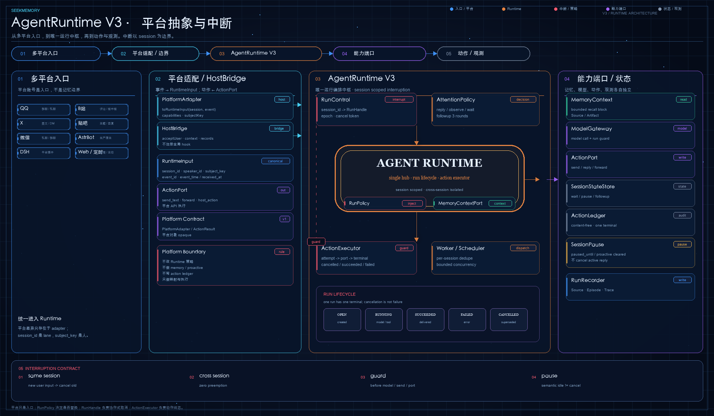
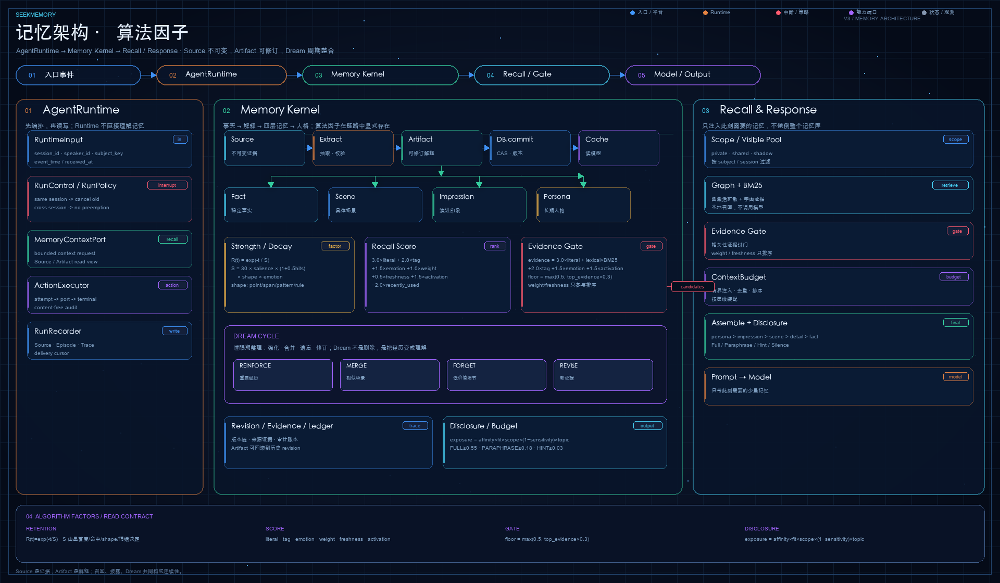
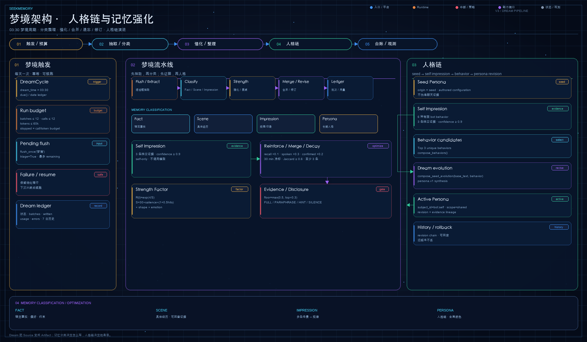

# SeekMemory Documentation

SeekMemory provides traceable, revisable memory for long-running conversations. These pages describe behavior in the current repository; they do not mirror issue, PR, RFC, or historical benchmark records.

## Start here

- [Architecture overview](architecture/overview.md): domain model, module boundaries, write path, and recall path.
- [Module design](architecture/modules/core.md): responsibilities and collaboration by code module.
- [Development setup and checks](guides/development.md): backend, dashboard, API, and test-layer workflows.
- [WebUI operations](guides/webui.md): memory library, diagnostics, maintenance jobs, and run traces.
- [Persona seed files](guides/persona-seed.md): validation, bootstrap, and later evolution.

## Modules

| Module | Design page |
|---|---|
| core | [Domain objects and pure policies](architecture/modules/core.md) |
| app | [Ports, DTOs, budgets, and application policies](architecture/modules/app.md) |
| services | [Use-case orchestration](architecture/modules/services.md) |
| store | [SQLite, version history, and cache](architecture/modules/store.md) |
| perceive | [Dialogue buffering and extraction](architecture/modules/perceive.md) |
| recall | [Candidate retrieval, disclosure, and assembly](architecture/modules/recall.md) |
| maintain | [Lifecycle, merging, and persona](architecture/modules/maintain.md) |
| Agent Runtime | [Session attention and runtime actions](architecture/modules/runtime.md) |
| adapters | [AstrBot host integration](architecture/modules/adapters.md) |
| WebUI | [Management API and dashboard](architecture/modules/webui.md) |

## Architecture diagrams

### AgentRuntime V3 · platform abstraction and interruption

A new intent in the same session replaces the old run; sessions never preempt each other. Cancellation is cooperative and distinct from semantic pause.

### Memory kernel · algorithm factors

Source is immutable evidence and Artifact is revisable interpretation. Recall is decided by strength, relevance, evidence gate, disclosure, and budget.

### Dream · persona chain and memory reinforcement

Dream classifies, reinforces, merges, forgets, and revises during the offline cycle, then carries stable behavior into one continuous persona chain.
